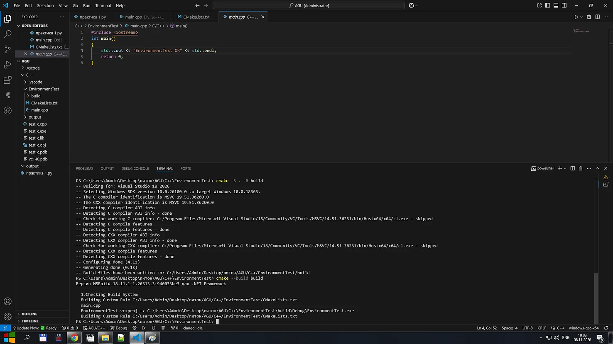
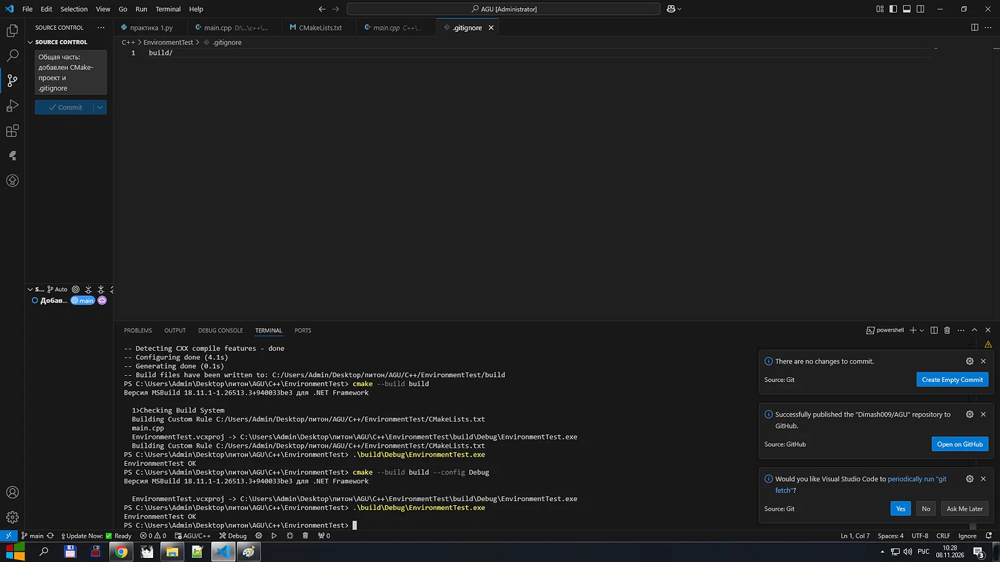
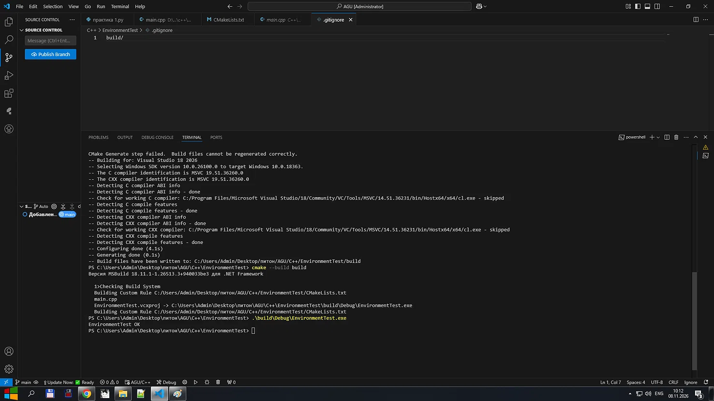
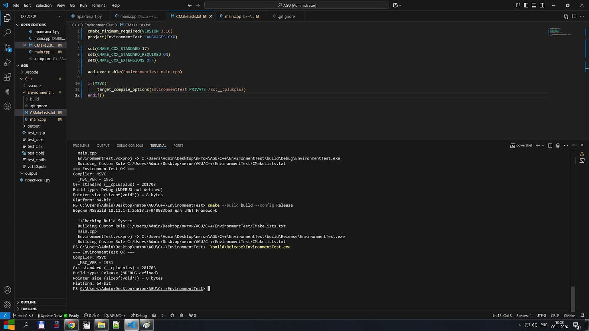

# Отчет по лабораторной работе: EnvironmentTest

**Выполнил:** Шевченко Д.М.  
**Группа:** 1ИВТ2

---

## 1. Настройка и проверка окружения

Проект был создан вручную в среде Visual Studio Code. Сборка производилась из терминала без использования графических кнопок IDE.

### 1.1. Вывод конфигурации CMake
Для конфигурации была выполнена команда: `cmake -S . -B build`.

<!-- Картинка 1 -->


### 1.2. Вывод приложения EnvironmentTest
Для сборки использовалась команда: `cmake --build build --config Debug`. При запуске приложение выдает корректный результат работы.

<!-- Картинка 2 -->


### 1.3. Поиск и запуск исполняемого файла
**Расположение исполняемого файла:** `build\Debug\EnvironmentTest.exe`

### 1.4. Настройка .gitignore
Был создан файл `.gitignore`, в который добавлена директория `build/`. Это исключает попадание временных файлов сборки и исполняемых файлов под контроль системы Git.

### 1.5. Фиксация в удаленном репозитории
Изменения были зафиксированы (commit) и отправлены (push) в публичный репозиторий на GitHub. 
Ссылка на репозиторий: [https://github.com/Dimash009/AGU](https://github.com/Dimash009/AGU)

---

## 2. Вариант 1. Информация о сборке

В рамках варианта 1 было изменено приложение для вывода информации о компиляторе, стандарте языка, типе сборки и разрядности платформы.

### 2.1. Листинг кода main.cpp

```cpp
#include <iostream> 

int main() { 
    std::cout << "=== EnvironmentTest OK ===\n"; 
    
#if defined(_MSC_VER) 
    std::cout << "Compiler: MSVC\n"; 
    std::cout << "  _MSC_VER = " << _MSC_VER << "\n"; 
#elif defined(__clang__) 
    std::cout << "Compiler: Clang\n"; 
    std::cout << "  __clang__ = " << __clang__ << "\n"; 
#elif defined(__GNUC__) 
    std::cout << "Compiler: GCC\n"; 
    std::cout << "  __GNUC__ = " << __GNUC__ << "\n"; 
#else 
    std::cout << "Compiler: Unknown\n"; 
#endif 

    std::cout << "C++ standard (__cplusplus) = " << __cplusplus << "\n"; 

#ifdef NDEBUG 
    std::cout << "Build type: Release (NDEBUG defined)\n"; 
#else 
    std::cout << "Build type: Debug (NDEBUG not defined)\n"; 
#endif 

    std::cout << "Pointer size (sizeof(void*)) = " << sizeof(void*) << " bytes\n"; 

    if (sizeof(void*) == 8) { 
        std::cout << "Platform: 64-bit\n"; 
    } else if (sizeof(void*) == 4) { 
        std::cout << "Platform: 32-bit\n"; 
    } else { 
        std::cout << "Platform: unknown bitness\n"; 
    }

    return 0; 
}
```

### 2.2. Результаты работы программы

#### Вывод конфигурации Отладка

<!-- Ссылка на картинку Debug -->


**Описание:** На данном скриншоте показан результат запуска приложения в конфигурации **Debug**. Программа выводит информацию о том, что используется компилятор MSVC (версия 1951), стандарт языка C++17 (`__cplusplus = 201703`), а тип сборки определен как **Debug** (так как макрос `NDEBUG` не определен). Также подтверждается 64-битная разрядность платформы (`sizeof(void*) = 8 bytes`).

#### Вывод конфигурации Релиз

<!-- Ссылка на картинку Release -->


**Описание:** На этом скриншоте показан запуск того же приложения, но собранного в конфигурации **Release**. В выводе программы видно, что параметры компилятора и стандарта языка остались прежними, но тип сборки изменился на **Release** (макрос `NDEBUG` теперь определен). Это доказывает, что настройки CMake корректно применяются для разных конфигураций.
